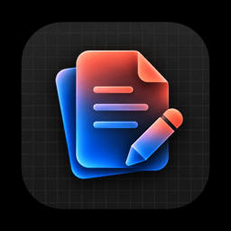

  

<h1 align="center">Super Docs</h1>

  <strong>Mac에서 문서, 스프레드시트, 프레젠테이션을 함께.</strong> 
  HWP · HWPX · DOCX · XLSX · PPTX · PDF · TXT · CSV · Markdown을 위한 무료 오픈소스 문서 앱

  
  
  
  

  <a href="https://github.com/jihyukboin/super-docs/releases/latest"><strong>다운로드</strong></a> ·
  <a href="https://jihyuk.tech/super-docs">웹사이트</a> ·
  <a href="#사용법">사용법</a> ·
  <a href="https://github.com/jihyukboin/super-docs/issues">문제 신고 · 기능 제안</a>

## 주요 기능

- **문서·표·슬라이드 편집** — HWP·HWPX·DOCX 본문, XLSX 셀·수식·서식, PPTX 슬라이드·텍스트·개체를 편집하고 원래 형식으로 저장합니다.
- **PDF 열람·편집** — 검색·확대/축소와 함께 강조 표시, 텍스트 메모 추가, 페이지 회전·삭제, 실행 취소·저장을 지원합니다.
- **텍스트 작업** — TXT 편집, CSV 표 편집, Markdown 원문 편집과 실시간 미리보기를 제공합니다.
- **오프라인 편집** — 문서 편집에 인터넷 연결이 필요하지 않습니다.
- **Mac에 익숙한 작업 흐름** — 여러 문서를 각각의 창에서 열고, 시스템 파일 선택창과 단축키로 작업합니다.
- **안전한 저장 흐름** — 저장하지 않은 변경 사항을 알리고, 다른 앱이 원본을 변경하면 덮어쓰기를 막습니다.
- **앱 내 업데이트** — 새 버전을 확인하고 설치를 안내합니다.

## 지원 형식과 환경

| 형식 | 열람 · 편집 | 저장 |
| --- | --- | --- |
| HWP | 지원 | HWP 또는 HWPX |
| HWPX | 지원 | HWPX 또는 HWP |
| DOCX | 지원 | DOCX |
| XLSX | 셀·수식·서식 편집 | XLSX |
| PPTX | 슬라이드·텍스트·개체 편집 | PPTX |
| PDF | 열람·주석·페이지 편집 | PDF |
| TXT | 텍스트 편집 | TXT 또는 Markdown |
| CSV | 표 편집 | CSV |
| Markdown | 원문 편집·미리보기 | Markdown 또는 TXT |

**Apple Silicon Mac (M1 이상) · macOS 14 이상**에서 사용할 수 있습니다. 파일 → 새 문서에서 형식을 선택합니다. `⌘N`은 HWPX 문서를 만듭니다. 형식별 제약은 [알아두세요](#알아두세요)를 확인해 주세요.

## 설치

1. [다운로드](https://github.com/jihyukboin/super-docs/releases/latest)에서 `.dmg` 파일을 받습니다.
2. DMG를 열고 **Super Docs**를 **Applications** 폴더로 드래그합니다.
3. 응용 프로그램 폴더에서 Super Docs를 실행합니다.

## 사용법

- **파일 → 열기** (`⌘O`): 지원하는 문서 열기
- **파일 → 새 문서** (`⌘N`): 형식을 선택해 새 문서 만들기 (`⌘N`은 HWPX)
- **저장** (`⌘S`): 편집한 문서 저장
- **다른 이름으로 저장** (`⇧⌘S`): 파일 이름과 저장 형식 선택 (HWP/HWPX 간 변환, DOCX는 DOCX로 저장)

본문·표·서식을 편집하고 여러 문서를 각각의 창에서 열 수 있습니다. 문서 편집에는 인터넷 연결이 필요하지 않습니다.

PDF 상단의 **PDF 편집** 메뉴에서 주석과 페이지를 편집합니다. 기존 PDF 본문을 워드프로세서처럼 재배치하는 기능은 제공하지 않습니다. 암호로 잠긴 PDF는 잠금을 해제한 후 열어 주세요.

TXT·Markdown·CSV는 UTF-8 및 BOM이 있는 UTF-16을 지원하며 원본 인코딩을 보존합니다. CSV는 따옴표로 감싼 쉼표·줄바꿈을 처리합니다. Markdown 미리보기는 제목·목록·표·코드 블록을 지원합니다.

## 업데이트

새 버전을 자동으로 확인하고 설치를 안내합니다. **Super Docs → 업데이트 확인…** 메뉴에서도 확인할 수 있습니다. 업데이트 확인과 다운로드에는 인터넷 연결이 필요합니다.

0.1.0을 사용 중이라면 위 다운로드 링크에서 새 버전을 한 번 설치해 주세요. 이후부터 앱에서 업데이트할 수 있습니다.

## 알아두세요

Office 엔진이 모든 Excel 수식·차트 표시·PowerPoint 애니메이션을 지원하는 것은 아닙니다. 복잡한 문서의 배치·글꼴·일부 개체는 한컴 앱이나 Microsoft Word와 다르게 표시될 수 있습니다. DOCX의 기본 본문·서식·표 편집을 지원하며, 변경 내용 추적과 메모 편집은 지원하지 않습니다. 암호 문서의 저장은 지원하지 않습니다. 중요한 문서는 원본을 보관하고 복사본으로 작업해 주세요.

## 문제 신고와 기능 제안

[GitHub Issues](https://github.com/jihyukboin/super-docs/issues)에 macOS 버전, Mac 모델, 앱 버전과 재현 방법을 남겨 주세요. 첨부 문서에는 개인정보와 기밀이 없는지 확인해 주세요.

## 오픈소스

[RHWP](https://github.com/edwardkim/rhwp)와 [DOCX Editor](https://github.com/eigenpal/docx-editor) 기반의 독립적인 앱입니다. Super Docs는 [MIT 라이선스](LICENSE)로 공개하며, 포함된 오픈소스의 고지는 [여기](Resources/THIRD_PARTY_NOTICES.txt)에서 확인할 수 있습니다. 코드 기여는 [기여 안내](CONTRIBUTING.md)를 참고해 주세요.
